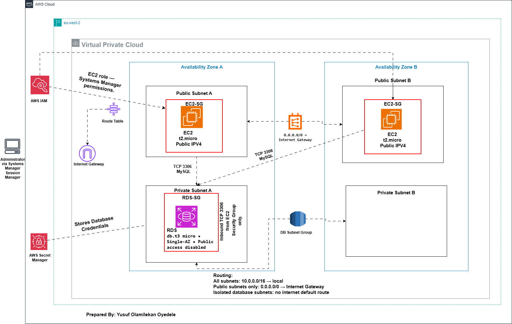

# TechHealth Infrastructure Migration

This project uses AWS CDK with TypeScript to define and deploy a patient portal infrastructure proof of concept in the London Region (eu-west-2).

The infrastructure includes:
- A VPC spanning two Availability Zones.
- One public and one isolated database subnet per Availability Zone.
- Two t2.micro EC2 instances, one in each public subnet.
- One Single-AZ db.t3.micro RDS MySQL database with public access disabled.
- A shared EC2 security group and an RDS security group allowing MySQL traffic only from the EC2 group.
- An EC2 IAM role for Systems Manager access.
- Database credentials generated and stored in AWS Secrets Manager.

No NAT Gateways are deployed to reduce recurring costs.

## Architecture



## Useful commands

* `npm run build`   type-check the project
* `npm run watch`   watch for changes and type-check
* `npm run test`    perform the jest unit tests
* `npx cdk deploy`  deploy this stack to your default AWS account/region
* `npx cdk diff`    compare deployed stack with current state
* `npx cdk synth`   emits the synthesized CloudFormation template
## Validation and Testing

The following checks were completed:

- TypeScript compilation with `npm run build`.
- CloudFormation template generation with `npx cdk synth`.
- Successful infrastructure deployment with `npx cdk deploy`.
- MySQL connectivity from both EC2 instances, verified using:
  ```sql
  SELECT 1 AS connection_test;
  ```

- RDS inbound access restricted to TCP 3306 from the shared EC2 security group.
- RDS public accessibility confirmed as disabled.
- Both isolated database subnet route tables confirmed to contain only the VPC-local route.
- Successful stack destruction and recreation using the same CDK code.
- MySQL connectivity verified again from both recreated EC2 instances.
Screenshots were captured as evidence of these checks.
## Limitations

This infrastructure is a learning proof of concept.

- The RDS database uses a Single-AZ deployment.
- The two EC2 instances do not have a load balancer or automatic failover.
- No patient portal application has been deployed.
- Administration uses Systems Manager Session Manager; inbound SSH is not enabled.
- The database is configured for deletion when the stack is destroyed. It must contain only disposable test data.
- Small instance sizes do not guarantee Free Tier coverage. Running instances, public IPv4 addresses, storage, and Secrets Manager may incur charges.
## Design Choices

- Two Availability Zones provide subnet capacity for future expansion.
- EC2 instances run in public subnets, as required by the project.
- RDS uses isolated subnets with no internet default route.
- A DB subnet group includes both isolated subnets, although the database runs in only one AZ.
- The RDS security group accepts MySQL traffic only from instances using the shared EC2 security group.
- Systems Manager provides administrative access without opening an inbound SSH port.
- Secrets Manager stores generated database credentials instead of hardcoding passwords.
- NAT Gateways are excluded to reduce recurring costs.
## Setup and Deployment

Prerequisites:
- Node.js and npm.
- AWS CLI with credentials for the intended AWS account.
- AWS permissions to bootstrap and deploy the infrastructure.

From the project folder:

```bash
npm ci
npm run build
aws sts get-caller-identity
```

Confirm the account is correct and the AWS Region is `eu-west-2`.

Bootstrap the account and Region once, replacing `YOUR_ACCOUNT_ID`:

```bash
npx cdk bootstrap aws://YOUR_ACCOUNT_ID/eu-west-2
```

Generate and review the template, then deploy:

```bash
npx cdk synth
npx cdk diff
npx cdk deploy
```

Deployment creates AWS resources that may incur charges.
## Cleanup

From the project folder, run:

```bash
npx cdk destroy
```

Review the stack name before confirming.

This deletes the lab EC2 instances, RDS database, and networking resources managed by the stack. The database uses `RemovalPolicy.DESTROY`, so its data is deleted without a final snapshot.

The separate `CDKToolkit` bootstrap stack remains. Check the AWS Console for retained resources, snapshots, or secrets after cleanup.
## Lessons Learned

- I learned the difference between `build`, `synth`, and `deploy`. Building checks and compiles the TypeScript code, while synthesis generates the CloudFormation template for review before deployment. These checks helped me catch errors early and understand which resources would be created.

- I learned how referencing the EC2 security group in the RDS inbound rule restricts MySQL connections to instances using that group. Disabling public access and placing RDS in isolated subnets provide additional network protection.

- I learned that destroying and recreating an EC2 instance produces a fresh server. Software installed manually, such as the MySQL client, must be installed again. This showed me why automated software installation would make future deployments more consistent.
## Testing Evidence

### Initial deployment
- [Deployment success](docs/screenshots/cdk-deployment-success.png)
- [AppServerA database connection](docs/screenshots/app-server-a-rds-connection.png)
- [AppServerB database connection](docs/screenshots/app-server-b-rds-connection.png)

### Database security and isolation
- [RDS security group](docs/screenshots/rds-security-group.png)
- [RDS public access disabled](docs/screenshots/rds-public-access-disabled.png)
- [Database subnet A routes](docs/screenshots/database-subnet-a-route.png)
- [Database subnet B routes](docs/screenshots/database-subnet-b-routes.png)

### Destruction and recreation
- [Stack destruction](docs/screenshots/cdk-destroy-success.png)
- [Redeployment success](docs/screenshots/cdk-redeployed-success.png)
- [Recreated AppServerA database connection](docs/screenshots/recreated-app-server-a-rds-connection.png)
- [Recreated AppServerB database connection](docs/screenshots/recreated-app-server-b-rds-connection.png)